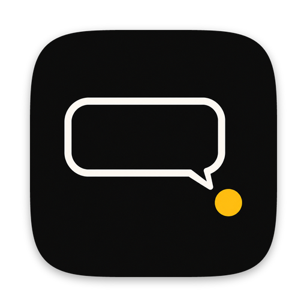
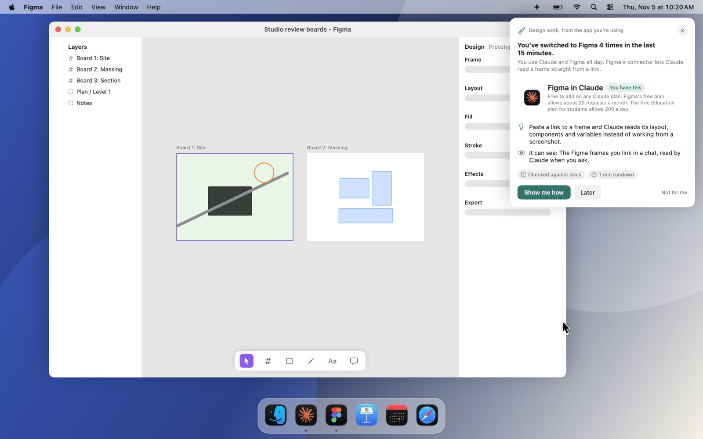
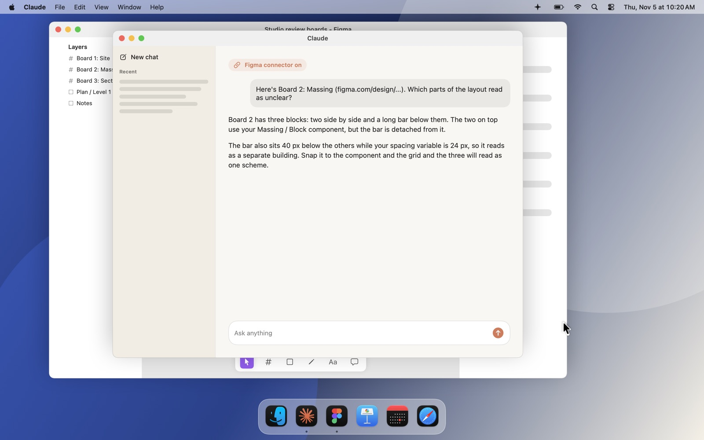
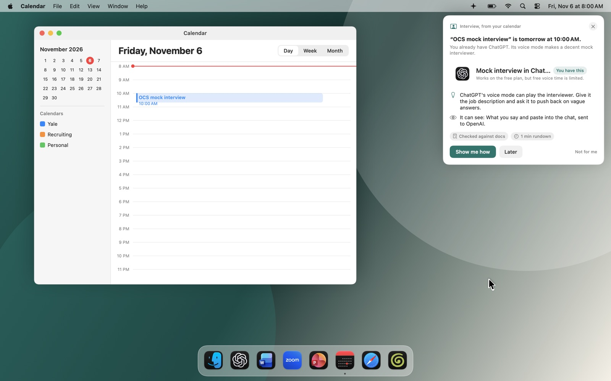
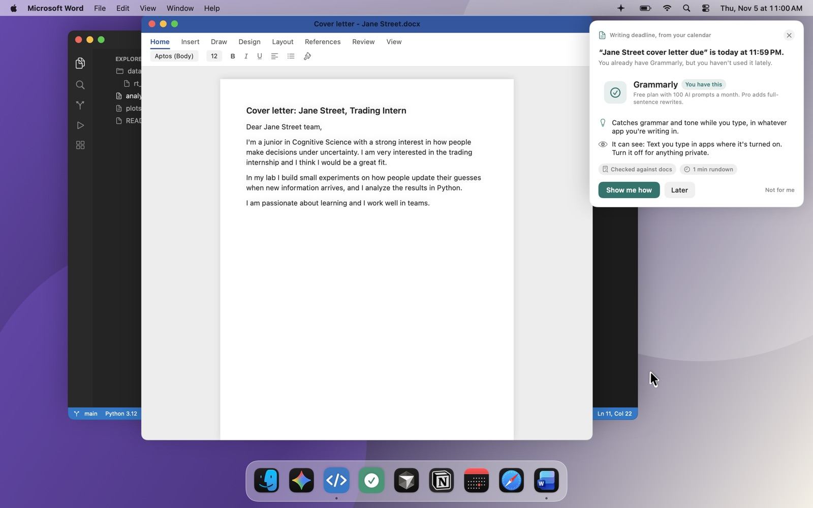
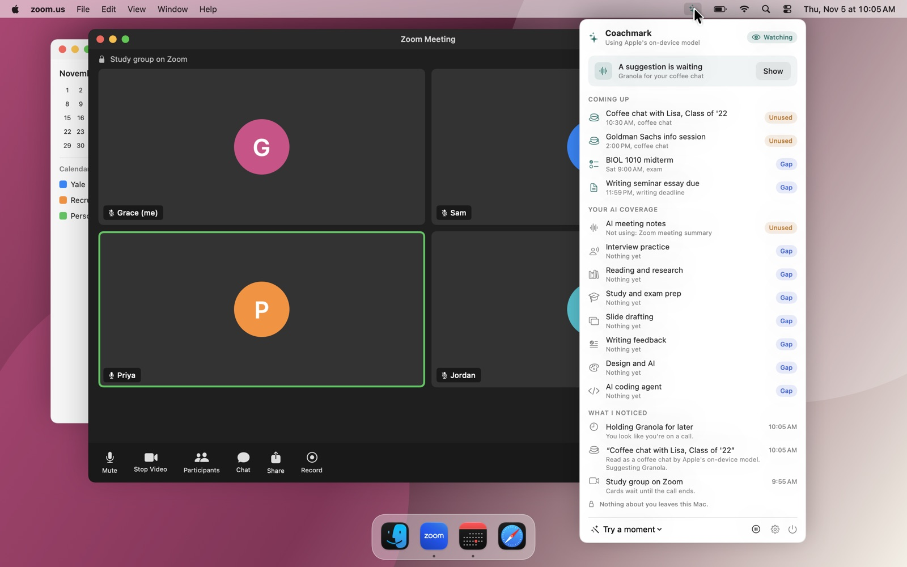
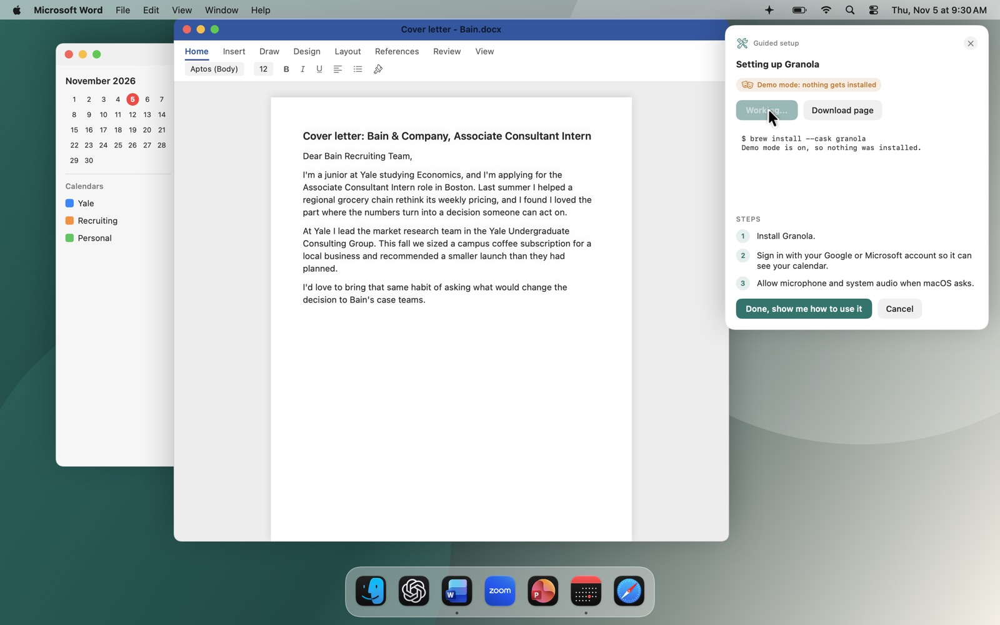

# Coachmark

**This repo is a proof of concept.** The best way to see it is the live demo:

### [Try the demo: background-ai-coach.vercel.app](https://background-ai-coach.vercel.app)

Coachmark is a Mac app that lives in the menu bar and notices the moments where AI would actually help, like a coffee chat in 15 minutes, a mock interview tomorrow or a deadline tonight. Then it shows you the best way to handle that moment with the AI tools you already have. The name comes from coach marks, the small hint bubbles that point at a feature to teach it right where you use it.

Most of the time that means a newer way to use an app you already use. It might be connecting Claude to Figma so it can read your real designs, adding an MCP server to Claude Code, keeping a course's readings in a Claude Project, or running a mock interview in ChatGPT's voice mode. Features like these keep shipping inside the apps students already use, and they're easy to miss. The app only suggests a new app when nothing you have covers the moment, and if you're already covered, it stays quiet.

*Theo keeps switching between Figma and Claude. He already uses Claude, so the app shows him Figma's connector for it.*

It's designed for college students who are curious about AI but aren't technical, and who are getting ready for internships and jobs.

## The demo

The demo plays a day on a made-up student's Mac. You pick the student most like you and step through their day. Each time the app shows a card, you choose what you'd do: set it up, "Later" or "Not for me". After two students there's a short survey.

| Student | Who they are | What their day shows |
| --- | --- | --- |
| Maya | Econ junior recruiting for consulting, uses ChatGPT's free plan | Granola suggested before a coffee chat, the one-card-a-day limit holding two later cards, and ChatGPT's voice mode for her mock interview the next morning |
| Theo | Architecture sophomore who does most of his thinking in Claude | Coaching on tools inside Claude before anything new: Figma's connector for Claude, Claude Projects and Claude Slides. Then "Not for me" sticking for the rest of the day |
| Ines | Sociology senior who's careful about privacy | Four quiet moments in a row, then one card all day for Big Interview, which Yale's career office gives students free |
| Dev | Cognitive Science junior with tools he never opens | Coaching on Grammarly, Cursor and Gemini that he already has, with no new installs |
| Grace | First-year with nothing set up | Nothing popping up during a Zoom call, and only one card on a day full of gaps |

The students are made up. Each one mixes patterns from several of our user interviews. The decisions in the demo come from the real app logic.

## The problem

New AI tools and features come out every week. For a student who isn't technical, it's hard to tell which ones are worth learning, and guessing wrong costs time they don't have. These are the pain points that kept coming up in our interviews.

- There's too much to keep up with. Students told us the hard part is knowing what's out there and which of it is actually good. So they either ignore tools that would help them or spend hours on ones that go nowhere.
- Even students who use ChatGPT or Claude every day miss what's new inside them. Connectors, MCP servers, skills, Projects and new modes keep shipping, and they're easy to miss unless you follow every changelog. Some students told us they rely on more technical friends to keep up.
- Hearing about a tool doesn't get anyone to use it. People try something new when it clearly fits a task they're doing right now. Separate tutorials feel like homework, so they get skipped.
- Setup gets in the way. Finding the right tool, signing up, installing it and configuring it all land right before the thing they needed it for. Many students also told us they won't download another app or pay for another subscription.
- They already own tools they don't use. An app they installed once, or a feature they're already paying for, sits there because nobody showed them when to reach for it.
- A bad first try sends them back to doing it by hand. If the first attempt takes more effort than the manual way, they give up on the tool.
- They don't want something watching them. Privacy came up again and again, from not wanting to give an AI access to their files to distrusting apps that ask for too much.
- It matters for getting hired. We heard that employers increasingly expect candidates to explain how they've actually used AI, and knowing a tool exists doesn't count as experience.

## More out of the AI you already use

The app's first job is teaching newer ways to use what you already have. A few examples from the prototype:

| Moment | If you use | What it shows you |
| --- | --- | --- |
| Design work in Figma | Claude | Figma's connector for Claude, so Claude reads your real frames and layers from a link. On Claude Code, it adds Figma's MCP server for you. |
| Mock interview tomorrow | ChatGPT | ChatGPT's voice mode playing the interviewer, with the job description loaded and told to push back on vague answers |
| Seminar readings | Claude or ChatGPT | A Project for each course, so every chat about that course already has the readings |
| Midterm coming up | Claude, ChatGPT or Gemini | Claude's learning mode, ChatGPT's study mode or Gemini's Guided Learning, which walk you through problems with questions |
| Group presentation | Claude | Claude Slides, which builds a deck you can edit and download as PowerPoint |

About half of the 31 entries in the prototype's catalog are features and add-ons like these, inside apps students already have. The full design adds Claude skills as well.

*After the one-minute rundown, Theo pastes a frame link into Claude, and Claude reads the real layout.*

*Maya already has ChatGPT, so before her mock interview the app shows her how to practice with its voice mode.*

## What it does

The app brings the right tool to students at the moment they need it and handles the setup. It runs the same loop every time something happens on the Mac.

1. It notices a moment. Apple's on-device model reads your calendar event titles and decides what kind of moment each one is, like a coffee chat, an interview or an exam. Going back and forth to the same app counts too, so switching to Figma four times in 15 minutes is a design moment.
2. It checks what you already have, including what's inside those apps. Tools are grouped into eight areas, like AI meeting notes, interview practice and study prep. It looks at your installed apps, your Claude Code setup and its MCP servers, and the features you use inside apps like ChatGPT, Claude and Gemini.
3. It decides. If you own something that fits, including a feature inside your main AI app, it coaches you on that. Things from the AI app you use most rank higher. It only suggests a new app when nothing you have covers that area.

   

4. It picks the right time. You get at most one card a day by default, and nothing pops up during a call. A held card waits in the menu bar until the next calm moment.

   

5. It shows a card that explains why this tool, what it costs, what it can see, and any consent note, like asking before you record someone.
6. It sets things up for you, like adding an MCP server to Claude Code, opening the right setting or installing an app. Then it walks you through using it for that exact moment.

   

7. It keeps a small log on your Mac of what happened to each card, including whether you came back to the tool within a week.

## Why it works this way

Each design choice answers one of the pain points above.

- It starts with what you already have. The students we talked to already use ChatGPT or Claude, and many won't add another app. Teaching them a connector, an MCP server or a Project in the app they already live in is the fastest way to get them more out of AI. New apps are kept for real gaps.
- It shows up at the moment of need, so the tool is tied to something you're about to do. That's when people are actually willing to try something new.
- It does the setup and gives you a walkthrough for that exact task, so the first try goes well and doesn't push you back to doing it by hand.
- It stays quiet most of the time. One card a day, nothing during calls, and "Not for me" sticks. If it interrupted all the time, people would turn it off.
- Everything personal stays on your Mac. Event titles are read by Apple's on-device model, and every card says what the tool can see. Nothing about you is uploaded.

## Planned system architecture

The full system diagram is on the [FigJam board](https://www.figma.com/board/DanmId5kR63iVwQ1qfaFuu/Product-System-Diagram?node-id=0-1&t=M3LBlZ7thfZx55GX-1). The full design has three parts.

1. The student's Mac. This is where everything personal lives. It notices moments, checks which tools you have, including connectors, MCP servers and skills, and decides whether to coach, suggest or stay quiet. Then it shows the card, runs the setup and keeps the log. None of that data leaves the Mac.
2. A shared catalog service in the cloud. Once a day it gathers what's new from the changelogs of Claude, ChatGPT and Gemini, launch feeds and vendor pages, so a new feature inside an app you already use gets picked up as fast as a new app. It pulls out facts like price and permissions, tests each one hands-on, scores how well it fits each kind of moment, and writes the setup steps. A person reviews the result before it goes out. Every Mac downloads the same public catalog, so the service never needs to know anything about you.
3. An opt-in feedback loop. If you allow it, your Mac sends back only which tool was suggested, whether you set it up and whether you came back to it within a week. No calendar, files or content. That helps the catalog score tools better for everyone.

The design also leaves room for an optional private cloud model for harder decisions. It would run in a sealed environment that keeps no logs and that we can't read.

## What the proof of concept covers

- It builds the Mac half of the design. The daily catalog service isn't built yet. In its place is a hand-picked catalog of 31 tools and features, checked against vendor pages on Oct 15, 2026.
- Skills are in the design but aren't in the prototype's catalog yet. MCP servers, connectors and features inside ChatGPT, Claude and Gemini are.
- The feedback loop and the private cloud model are designed but not built.
- A next version that also notices how you work, if you turn it on, is in progress on the `screen-aware` branch. It reads the window you're in, all on your Mac, and suggests better ways to use apps you already have, with a prompt ready to paste.
